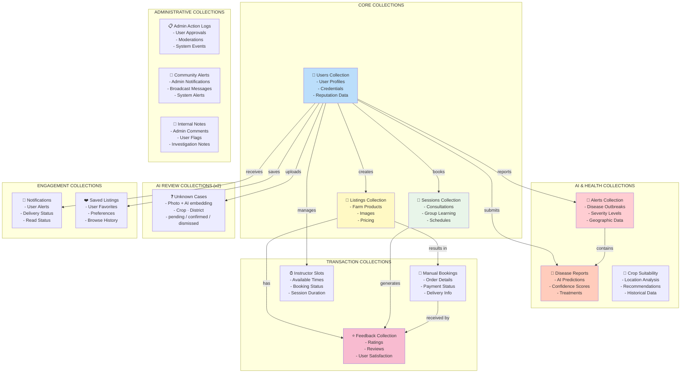

# 💾 Govi Isuru - Database Schema & Data Models

## MongoDB Collections Architecture



---

## User Collection Schema

```
User {
  _id: ObjectId (MongoDB auto-generated)
  
  AUTHENTICATION FIELDS:
  ├── username: String (unique) [Required]
  ├── fullName: String [Required]
  ├── email: String (unique, lowercase) [Required]
  ├── password: String (bcrypt hashed) [Required]
  ├── isEmailVerified: Boolean [default: false]
  ├── verificationToken: String
  ├── verificationTokenExpires: Date
  ├── passwordResetToken: String
  ├── passwordResetExpires: Date
  
  LOCATION & REGION:
  ├── district: String [Required]
  │   Example: "Colombo", "Kandy", "Jaffna"
  ├── dsDivision: String [Required]
  │   (Divisional Secretary Division)
  └── gnDivision: String [Required]
      (Grama Niladhari Division - smallest admin unit)
  
  CONTACT:
  └── phone: String
      Format: +94XXXXXXXXX (Sri Lanka code)
  
  ROLE-BASED FIELDS:
  ├── role: Enum [
  │   "farmer" (default) - primary users
  │   "officer" - agricultural instructors
  │   "buyer" - bulk purchasers
  │   "admin" - system administrators
  │   "moderator" - content moderators
  │ ]
  ├── officerId: String (for officers only)
  │   Example: "AGI-001-2024"
  ├── department: String (for officers)
  │   Example: "Department of Agriculture"
  └── designation: String (for officers)
      Example: "Agricultural Instructor"
  
  OFFICER APPROVAL WORKFLOW:
  ├── isApproved: Boolean [default: true for farmers/buyers]
  ├── approvalStatus: Enum [
  │   "pending" - awaiting admin approval
  │   "approved" - verified
  │   "rejected" - not qualified
  │ ]
  ├── approvedBy: ObjectId (ref: User)
  ├── approvedAt: Date
  └── rejectionReason: String
  
  CREDIT SYSTEM:
  ├── credits: Number [default: 200]
  │   Current available credits
  ├── dailyLimit: Number [default: 200]
  │   Maximum credits per day
  ├── lastCreditReset: Date [default: now]
  │   Timestamp of last daily reset
  └── isPremium: Boolean [default: false]
      Unlimited credits if true
  
  FARMER REPUTATION:
  ├── reputation_score: Number [1-5] [default: 3.0]
  │   Average of all feedback ratings
  ├── total_sales: Number [default: 0]
  │   Count of completed transactions
  ├── verified_listings: Number [default: 0]
  │   Count of quality-verified listings
  ├── total_feedbacks: Number [default: 0]
  │   Count of feedback received
  └── is_verified_farmer: Boolean [default: false]
      Badge: reputation_score >= 4.0
  
  FRAUD DETECTION:
  ├── false_report_count: Number [default: 0]
  │   Count of invalidated disease reports
  ├── account_flagged: Boolean [default: false]
  │   Prevent account if >= 3 false reports
  └── last_report_at: Date
      Timestamp of last report submitted
  
  BUYER SPECIFIC:
  └── savedListings: [ObjectId (ref: Listing)]
      Array of favorite listings
  
  METADATA:
  └── createdAt: Date [default: now]
      Account creation timestamp
  
  INDEXES:
  "reputation_score": -1 (for sorting top farmers)
  "role": 1 (for role-based queries)
  "account_flagged": 1 (for moderation)
  "district": 1, "role": 1 (geographic queries)
  "verificationToken": 1 (token lookup)
}
```

---

## Listing Collection Schema

```
Listing {
  _id: ObjectId
  
  BASIC INFORMATION:
  ├── farmerId: ObjectId (ref: User) [Required]
  │   Creator of the listing
  ├── cropType: String [Required]
  │   Enum: "rice", "tea", "chili", "vegetables", "fruits"
  ├── variety: String
  │   Example: "Basmati", "Green Tea", "Red Chili"
  ├── description: String
  │   Detailed product description
  └── quality: String
      Enum: "A", "B", "C" (grade classification)
  
  INVENTORY & PRICING:
  ├── quantity: Number [Required]
  │   Available quantity in KG
  ├── price_per_kg: Number [Required]
  │   Price in LKR (Sri Lankan Rupees)
  ├── total_value: Number
  │   quantity * price_per_kg
  ├── harvested_date: Date
  │   Date of harvest
  └── expiry_date: Date
      Best-by date
  
  IMAGES:
  ├── images: [String]
  │   Array of image file paths
  │   Max: 5 images per listing
  │   Format: "uploads/listings/listing-{timestamp}-{random}.jpg"
  └── image_md5: String
      Hash for deduplication
  
  LOCATION:
  ├── district: String
  │   Inherited from farmer
  ├── gn_division: String
  │   Inherited from farmer
  └── coordinates: {
        lat: Number,
        lng: Number
      }
      GPS coordinates
  
  STATUS & VISIBILITY:
  ├── status: String [default: "ACTIVE"]
  │   Enum: "ACTIVE", "SOLD_OUT", "ARCHIVED", "DELETED"
  ├── is_verified: Boolean [default: false]
  │   Verified by officers for quality
  └── featured: Boolean [default: false]
      Promoted listings
  
  ENGAGEMENT:
  ├── views: Number [default: 0]
  │   Total view count
  ├── saved_by: [ObjectId (ref: User)]
  │   Users who saved this listing
  ├── contact_count: Number [default: 0]
  │   Number of buyer inquiries
  └── rating: Number (1-5)
      Average from transactions
  
  BOOKING & SALES:
  ├── manual_bookings: [ObjectId (ref: ManualBooking)]
  │   Associated orders
  ├── sold_quantity: Number [default: 0]
  │   Total quantity sold
  └── sales: [
      {
        buyer_id: ObjectId (ref: User),
        quantity: Number,
        price: Number,
        sold_at: Date,
        status: "completed" | "pending"
      }
    ]
  
  METADATA:
  ├── created_at: Date [default: now]
  ├── updated_at: Date [default: now]
  └── last_contact_at: Date
      Last buyer inquiry
  
  COMPOUNDS:
  └── farmer_info: {
        name: String,
        rating: Number,
        verified: Boolean
      }
      Denormalized for fast query
  
  INDEXES:
  "farmerId": 1
  "cropType": 1
  "district": 1
  "status": 1
  "created_at": -1
  "rating": -1
}
```

---

## Disease Report Collection Schema

```
DiseaseReport {
  _id: ObjectId
  
  SUBMITTER & LOCATION:
  ├── user_id: ObjectId (ref: User) [Required]
  │   Farmer who submitted
  ├── username: String
  └── location: {
      district: String,
      gn_division: String,
      coordinates: {
        lat: Number,
        lng: Number
      }
    }
  
  CROP & DISEASE INFORMATION:
  ├── crop_type: String [Required]
  │   "rice", "tea", "chili"
  ├── disease_detected: String
  │   AI detected disease name
  │   Example: "Leaf Blast", "Brown Spot"
  ├── severity: String
  │   Enum: "LOW", "MEDIUM", "HIGH"
  │   Farmer's assessment
  └── affected_area: String
      Area percentage: "0-10%", "10-50%", "50%+"
  
  AI DIAGNOSIS:
  ├── ai_confidence: Number (0-1)
  │   0.97 = 97% confidence
  ├── ai_severity: String
  │   AI-assessed severity
  ├── model_version: String
  │   Which model was used
  │   Example: "keras_v2_rice"
  ├── gradcam_image: String
  │   Base64 encoded heatmap visualization
  └── leaf_likeness_score: Number (0-1)
      Verification that image is actual leaf
  
  TREATMENTS RECOMMENDED:
  ├── treatments: [
      {
        name: String,
        description: String,
        steps: [String],
        duration: String,
        effectiveness: String
      }
    ]
  ├── prevention_measures: [String]
  │   Steps to prevent future occurrence
  └── resource_links: [String]
      URLs to government guidance
  
  IMAGE DATA:
  ├── image_id: String
  │   MD5 hash of image
  ├── image_url: String
  │   Path to original image
  ├── image_size: Number (bytes)
  └── image_format: String
      "JPEG" | "PNG"
  
  REPORTING STATUS:
  ├── is_private: Boolean [default: true]
  │   Only visible to farmer initially
  ├── shared_as_alert: Boolean [default: false]
  │   Farmer promoted to community alert
  └── alert_id: ObjectId (ref: Alert)
      Link to community alert if created
  
  VERIFICATION WORKFLOW:
  ├── verified_by_officer: Boolean [default: false]
  ├── verified_by_officer_id: ObjectId (ref: User)
  ├── verification_date: Date
  ├── officer_notes: String
  │   Officer's additional observations
  └── verification_status: String
      Enum: "VERIFIED", "DISPUTED", "INCONCLUSIVE"
  
  USER RATINGS:
  ├── farmer_satisfaction: Number (1-5)
  │   How useful was the AI diagnosis
  ├── farmer_feedback: String
  │   Feedback on accuracy
  └── verified_accuracy: Boolean
      Field confirmed AI diagnosis correct
  
  METADATA:
  ├── created_at: Date [default: now]
  ├── updated_at: Date
  └── ttl: Number (30 days)
      Auto-delete after 30 days if private
  
  INDEXES:
  "user_id": 1
  "crop_type": 1
  "disease_detected": 1
  "created_at": -1
  "verified_by_officer": 1
}
```

---

## Alert Collection Schema

```
Alert {
  _id: ObjectId
  
  ALERT IDENTIFICATION:
  ├── alert_type: String
  │   Enum: "DISEASE_OUTBREAK", "PEST_WARNING", "WEATHER"
  ├── alert_title: String
  │   "Leaf Blast Outbreak in Colombo District"
  ├── alert_description: String
  │   Detailed explanation
  └── severity_level: String
      Enum: "LOW", "MEDIUM", "HIGH", "CRITICAL"
  
  GEOGRAPHIC SCOPE:
  ├── affected_districts: [String]
  │   Array of district names
  ├── affected_gn_divisions: [String]
  │   Specific GN divisions affected
  ├── affected_area_radius_km: Number
  │   Radius of affected area
  └── geo_cluster: {
      center_lat: Number,
      center_lng: Number,
      polygon: [[Number, Number]]
    }
  
  DISEASE INFORMATION:
  ├── disease_name: String
  │   Example: "Leaf Blast"
  ├── crop_affected: String
  ├── disease_report_id: ObjectId (ref: DiseaseReport)
  │   Original report that triggered this
  ├── similar_reports_count: Number
  │   How many other farmers reported same
  └── confidence_score: Number
      Composite confidence from multiple reports
  
  ALERT CREATION & WORKFLOW:
  ├── created_by: ObjectId (ref: User)
  │   Usually a farmer or officer
  ├── created_at: Date [Required]
  │   Timestamp of alert creation
  ├── status: String
  │   Enum: "PENDING", "APPROVED", "RESOLVED", "ARCHIVED"
  │   PENDING → officer must review
  │   APPROVED → broadcast to community
  │   RESOLVED → disease contained
  │   ARCHIVED → historical record
  └── status_updated_at: Date
  
  OFFICER APPROVAL:
  ├── reviewed_by_officer_id: ObjectId (ref: User)
  │   Officer who approved/rejected
  ├── reviewed_at: Date
  ├── officer_verification: String
  │   Officer's field assessment notes
  └── rejection_reason: String
      If rejected, why
  
  SPREAD ANALYSIS:
  ├── spread_rate_km_per_day: Number
  │   Estimated spread speed
  ├── predicted_affected_area: [String]
  │   Projected affected regions in 7 days
  ├── weather_conditions: {
      current_temp: Number (°C),
      humidity: Number (%),
      rainfall: Number (mm),
      wind_speed: Number (km/h),
      forecast_3_days: [String]
    }
  └── growth_factor: String
      "RAPID" | "MODERATE" | "SLOW"
  
  MITIGATION MEASURES:
  ├── recommended_treatments: [
      {
        name: String,
        description: String,
        cost_estimate: String,
        time_to_implement: String,
        effectiveness_rating: Number
      }
    ]
  ├── preventive_measures: [String]
  ├── quarantine_measures: [String]
  │   For high-severity alerts
  └── resource_links: [
      {
        title: String,
        url: String,
        source: String
      }
    ]
  
  NOTIFICATIONS & REACH:
  ├── notification_sent_to_users: [ObjectId (ref: User)]
  │   All farmers notified
  ├── notification_count: Number
  ├── notification_channels: [String]
  │   "PUSH", "EMAIL", "SMS"
  ├── viewed_by_users: [ObjectId (ref: User)]
  │   Who actually read it
  └── view_count: Number
  
  COMMUNITY ENGAGEMENT:
  ├── comments: [
      {
        user_id: ObjectId,
        comment: String,
        created_at: Date
      }
    ]
  ├── photos_uploaded: [
      {
        user_id: ObjectId,
        image_url: String,
        caption: String
      }
    ]
  └── success_stories: [String]
      "We implemented treatment X and it worked"
  
  RESOLUTION:
  ├── resolved_at: Date
  ├── resolved_by: ObjectId (ref: User)
  ├── resolution_method: String
  │   "TREATMENT_EFFECTIVE", "WEATHER_CHANGE", "SEASON_ENDED"
  └── lessons_learned: String
  
  METADATA:
  ├── views: Number [default: 0]
  ├── shares: Number [default: 0]
  └── created_at: Date [default: now]
  
  INDEXES:
  "affected_districts": 1
  "severity_level": -1
  "status": 1
  "created_at": -1
  "crop_affected": 1
}
```

---

## Feedback Collection Schema

```
Feedback {
  _id: ObjectId
  
  FEEDBACK TYPE & CONTEXT:
  ├── feedback_type: String [Required]
  │   Enum: "LISTING", "CONSULTATION", "DISEASE_REPORT", "GENERAL"
  │   - LISTING: feedback on marketplace transaction
  │   - CONSULTATION: feedback on session with officer
  │   - DISEASE_REPORT: feedback on AI diagnosis accuracy
  │   - GENERAL: general user satisfaction
  ├── target_id: ObjectId
  │   Reference to the thing being reviewed
  │   (Listing._id or Session._id or DiseaseReport._id)
  └── target_type: String
      "listing" | "session" | "disease_report" | "user"
  
  REVIEWER & REVIEWEE:
  ├── reviewer_id: ObjectId (ref: User) [Required]
  │   Person giving feedback
  ├── reviewer_name: String
  ├── reviewer_role: String (farmer/buyer/officer)
  ├── target_user_id: ObjectId (ref: User)
  │   Person being reviewed (if applicable)
  └── target_user_name: String
  
  RATING SYSTEM:
  ├── rating: Number [Required] (1-5 stars)
  │   Integer from 1 to 5
  │   1 = Very Poor
  │   5 = Excellent
  ├── rating_breakdown: {
      quality: Number (1-5),      [for listings]
      freshness: Number (1-5),    [for listings]
      timeliness: Number (1-5),   [for consultations]
      clarity: Number (1-5),      [for consultations]
      helpfulness: Number (1-5),  [for disease reports]
      accuracy: Number (1-5)      [for disease reports]
    }
  └── star_display: String
      Visual representation "⭐⭐⭐⭐⭐"
  
  TEXT FEEDBACK:
  ├── review_text: String
  │   User's written comment (0-500 chars)
  │   Example: "Great quality produce, very fresh!"
  ├── what_went_well: String
  │   Specific positive aspect
  ├── what_needs_improvement: String
  │   Constructive criticism
  └── would_recommend: Boolean
      "[Yes/No] I would recommend this [farmer/officer]"
  
  TRANSACTION CONTEXT:
  ├── transaction_id: ObjectId (ref: ManualBooking)
  │   Associated order/booking
  ├── transaction_amount: Number
  │   Value of transaction being reviewed
  ├── transaction_date: Date
  │   When the transaction occurred
  └── delivery_status: String
      "completed" | "partial" | "issues"
  
  VERIFICATION:
  ├── is_verified_purchase: Boolean
  │   True if reviewer actually bought from reviewee
  ├── verified_at: Date
  │   When verification occurred
  └── verification_method: String
      "EMAIL", "PHONE", "TRANSACTION_ID"
  
  MODERATION:
  ├── is_approved: Boolean [default: true]
  │   Admin approved before showing
  ├── flagged_for_review: Boolean [default: false]
  │   Potentially spam/abusive
  ├── rejection_reason: String
  │   Why deleted if not approved
  └── is_flagged_as_spam: Boolean
      Duplicate or fake review
  
  IMPACT METRICS:
  ├── helpful_count: Number [default: 0]
  │   Others marked as helpful
  ├── unhelpful_count: Number [default: 0]
  ├── report_count: Number [default: 0]
  │   Reported as inappropriate
  └── response_from_seller: String
      Seller's reply (if allowed)
  
  TARGETING & VISIBILITY:
  ├── is_public: Boolean [default: true]
  │   Visible in public profile/listing
  ├── visible_to_user: Boolean [default: true]
  │   Person being reviewed can see it
  └── is_featured: Boolean [default: false]
      Highlighted as top review
  
  METADATA:
  ├── created_at: Date [Required] [default: now]
  ├── updated_at: Date
  ├── language: String
  │   "en" | "si" | "ta"
  └── location_context: String
      Where the transaction occurred
  
  INDEXES:
  "target_id": 1, "target_type": 1
  "target_user_id": 1
  "rating": -1
  "created_at": -1
  "is_approved": 1
}
```

---

## Session Collection Schema

```
Session {
  _id: ObjectId
  
  PARTICIPANTS:
  ├── instructor_id: ObjectId (ref: User) [Required]
  │   Agricultural Officer/Instructor
  ├── instructor_name: String
  ├── farmer_id: ObjectId (ref: User) [Required]
  │   Farmer attending session
  ├── farmer_name: String
  └── farmer_district: String
  
  SESSION DETAILS:
  ├── session_type: String
  │   Enum: "ONE_ON_ONE", "GROUP_LEARNING", "WORKSHOP"
  ├── topic: String [Required]
  │   "Leaf Blast Treatment", "Yield Optimization"
  ├── description: String
  │   Detailed session description
  ├── crop_type: String
  │   Focus crop if applicable
  └── expertise_area: String
      Problem being addressed
  
  SCHEDULING:
  ├── scheduled_date: Date [Required]
  ├── scheduled_time: String
  │   Format: "14:30" (24-hour)
  ├── timezone: String
  │   "Asia/Colombo" (Sri Lanka timezone)
  ├── duration_minutes: Number [Required]
  │   Usually 30, 45, or 60 minutes
  ├── slot_id: ObjectId (ref: InstructorSlot)
  │   Reference to availability slot
  └── booking_date: Date
      When farmer booked the session
  
  SESSION MODE:
  ├── session_mode: String
  │   Enum: "VIDEO_CALL", "AUDIO_CALL", "IN_PERSON", "GROUP_LIVE"
  ├── meeting_link: String
  │   Zoom/Google Meet URL
  ├── meeting_id: String
  │   Unique meeting identifier
  ├── password: String
  │   If meeting requires password
  └── instructions: String
      How to join/access
  
  CREDIT SYSTEM:
  ├── credits_charged: Number
  │   Standard: 50 credits/session
  ├── credits_status: String
  │   Enum: "PENDING", "CHARGED", "REFUNDED"
  │   PENDING → credits charged right before session
  │   CHARGED → successfully deducted
  │   REFUNDED → if cancelled within 24h
  ├── payment_method: String
  │   "CREDITS" | "PREMIUM"
  └── transaction_id: String
      Reference to payment record
  
  SESSION STATUS:
  ├── status: String
  │   Enum: "SCHEDULED", "IN_PROGRESS", "COMPLETED", "CANCELLED", "NO_SHOW"
  ├── started_at: Date
  │   Actual start time
  ├── ended_at: Date
  │   Actual end time
  ├── actual_duration_minutes: Number
  │   Actual session length
  └── cancellation_reason: String
      If cancelled, why
  
  SESSION CONTENT:
  ├── session_notes: String
  │   Notes taken during session
  ├── key_points_discussed: [String]
  │   Summary of topics
  ├── action_items: [
      {
        item: String,
        assigned_to: "farmer" | "instructor",
        due_date: Date
      }
    ]
  ├── resources_shared: [
      {
        name: String,
        url: String,
        type: "PDF" | "VIDEO" | "LINK" | "IMAGE"
      }
    ]
  ├── follow_up_needed: Boolean
  ├── follow_up_date: Date
  │   Scheduled follow-up if needed
  └── recording_url: String
      Video recording if saved (storage costs)
  
  ATTENDANCE:
  ├── farmer_joined: Boolean
  ├── farmer_joined_at: Date
  ├── farmer_left_at: Date
  ├── instructor_joined: Boolean
  ├── instructor_joined_at: Date
  └── instructor_left_at: Date
  
  FEEDBACK AFTER SESSION:
  ├── farmer_feedback_id: ObjectId (ref: Feedback)
  ├── farmer_rating: Number (1-5)
  ├── farmer_rating_date: Date
  ├── instructor_feedback: String
  │   Notes from instructor perspective
  └── instructor_rating_farmer: Number (1-5)
  
  GEOLOCATION:
  ├── farmer_location: {
      district: String,
      gn_division: String,
      coordinates: {
        lat: Number,
        lng: Number
      }
    }
  └── instructor_location: {
      district: String,
      coordinates: {
        lat: Number,
        lng: Number
      }
    }
  
  METADATA:
  ├── created_at: Date [default: now]
  ├── updated_at: Date
  └── reminder_sent: Boolean
      24h and 1h reminders sent
  
  INDEXES:
  "instructor_id": 1
  "farmer_id": 1
  "scheduled_date": 1
  "status": 1
  "created_at": -1
  "instructor_id": 1, "scheduled_date": 1
}
```

---

## Manual Booking Collection Schema

```
ManualBooking {
  _id: ObjectId
  
  PARTICIPANTS:
  ├── buyer_id: ObjectId (ref: User) [Required]
  ├── buyer_name: String
  ├── farmer_id: ObjectId (ref: User) [Required]
  ├── farmer_name: String
  └── farmer_contact: String
  
  LISTING DETAILS:
  ├── listing_id: ObjectId (ref: Listing) [Required]
  ├── crop_type: String
  ├── variety: String
  └── quality_grade: String
  
  ORDER INFORMATION:
  ├── quantity_ordered: Number (kg) [Required]
  ├── quantity_confirmed: Number (kg)
  │   What farmer confirmed available
  ├── quantity_delivered: Number (kg)
  │   Actual delivery amount
  ├── agreed_price_per_kg: Number (LKR) [Required]
  ├── total_order_value: Number (LKR)
  │   quantity * agreed_price_per_kg
  └── negotiation_notes: String
      Any price/terms discussion
  
  DELIVERY DETAILS:
  ├── delivery_method: String
  │   Enum: "FARMER_PICKUP", "BUYER_PICKUP", "COURIER", "OTHER"
  ├── delivery_location: {
      address: String,
      district: String,
      gn_division: String,
      coordinates: {
        lat: Number,
        lng: Number
      }
    }
  ├── scheduled_delivery_date: Date [Required]
  ├── scheduled_delivery_time: String
  ├── actual_delivery_date: Date
  ├── actual_delivery_time: String
  ├── delivery_status: String
  │   Enum: "PENDING", "IN_TRANSIT", "COMPLETED", "FAILED"
  └── delivery_notes: String
      Any special instructions
  
  PAYMENT INFORMATION:
  ├── payment_method: String
  │   "CASH", "BANK_TRANSFER", "MOBILE_MONEY", "CHEQUE"
  ├── payment_status: String
  │   Enum: "PENDING", "PARTIAL", "COMPLETED", "DISPUTE"
  ├── payment_received_date: Date
  ├── receipt_number: String
  │   For tracking payment
  ├── outstanding_amount: Number (LKR)
  │   If partial payment
  └── payment_terms: String
      "50% advance, 50% on delivery"
  
  COMMUNICATION:
  ├── messages: [
      {
        sender_id: ObjectId,
        message: String,
        created_at: Date,
        attachments: [String]
      }
    ]
  └── last_contact_date: Date
  
  QUALITY CONTROL:
  ├── quality_inspection_required: Boolean
  ├── inspector_id: ObjectId (ref: User)
  │   Officer inspector if needed
  ├── inspection_passed: Boolean
  ├── inspection_notes: String
  ├── issues_found: [String]
  │   List of quality issues
  └── resolution_method: String
      What was done about issues
  
  BOOKING STATUS:
  ├── status: String [Required]
  │   Enum: "CONFIRMED", "IN_PROGRESS", "COMPLETED", "CANCELLED", "DISPUTE"
  ├── created_at: Date [default: now]
  ├── confirmed_date: Date
  ├── completion_date: Date
  └── cancellation_reason: String
  
  DISPUTE MANAGEMENT:
  ├── dispute_raised: Boolean
  ├── dispute_raised_by: "buyer" | "farmer"
  ├── dispute_reason: String
  ├── dispute_resolution: String
  │   How it was resolved
  ├── dispute_resolved_date: Date
  └── dispute_notes: String
  
  FEEDBACK:
  ├── feedback_id: ObjectId (ref: Feedback)
  ├── buyer_feedback: String
  ├── farmer_feedback: String
  ├── rating_from_buyer: Number (1-5)
  └── rating_from_farmer: Number (1-5)
  
  METADATA:
  ├── order_number: String
  │   Auto-generated unique order ID
  ├── reference_number: String
  │   For farmer's records
  └── notes: String
      Internal notes
  
  INDEXES:
  "buyer_id": 1
  "farmer_id": 1
  "listing_id": 1
  "status": 1
  "created_at": -1
  "scheduled_delivery_date": 1
}
```

---

## Unknown Case Collection Schema (v2)

Photos the AI service could not match to any known disease (`UNKNOWN_DISEASE`). Officers group, confirm or dismiss
them (`/api/ai/unknown-cases/*`). Model: `src/models/UnknownCase.js`.

| Field | Type | Notes |
|---|---|---|
| `user` | ObjectId → User | farmer who sent the photo |
| `crop` | `rice` \| `tea` \| `chili` | required |
| `district` | String | from the request or the farmer's profile |
| `imagePath` | String | `/uploads/unknown/<file>` |
| `embedding` | String | `embedding_f16_base64` from the AI service, used for grouping and for registering a new disease |
| `nearestKnown` | String | closest known class, as a hint for the officer |
| `status` | `pending` \| `confirmed` \| `dismissed` | default `pending` |
| `confirmedLabel` | String | snake_case id given by the officer, e.g. `rice_false_smut` |
| `reviewedBy`, `reviewedAt` | ObjectId → User, Date | set on confirm or dismiss |
| `modelVersion` | String | AI bundle version that produced the answer |
| `createdAt`, `updatedAt` | Date | timestamps |

Indexes: `{crop: 1, status: 1, createdAt: -1}` for the review list, `{district: 1, createdAt: -1}` for outbreak checks.

When three or more pending cases of one crop come from one district within 7 days, every approved officer of that
district receives a `disease_alert` notification (`src/services/unknownOutbreakService.js`).

---

## Data Relationships Diagram

```mermaid
erDiagram
    USER ||--o{ LISTING : creates
    USER ||--o{ DISEASE_REPORT : submits
    USER ||--o{ ALERT : reports
    USER ||--o{ SESSION : attends
    USER ||--o{ MANUAL_BOOKING : participates
    USER ||--o{ FEEDBACK : gives
    USER ||--o{ INSTRUCTOR_SLOT : manages
    USER ||--o{ SAVED_LISTINGS : saves
    
    LISTING ||--o{ MANUAL_BOOKING : "has"
    LISTING ||--o{ FEEDBACK : "receives"
    LISTING ||--o{ SAVED_LISTINGS : "saved by"
    
    DISEASE_REPORT ||--o{ ALERT : "triggers"
    DISEASE_REPORT ||--o{ FEEDBACK : "receives"
    
    ALERT ||--o{ SESSION : "may result in"
    
    SESSION ||--o{ FEEDBACK : "receives"
    SESSION ||--o{ INSTRUCTOR_SLOT : "uses"
    
    MANUAL_BOOKING ||--o{ FEEDBACK : "receives"
    
    USER : ObjectId _id
    USER : String username
    USER : String email
    USER : String role
    USER : Number credits
    USER : Number reputation_score
    
    LISTING : ObjectId _id
    LISTING : ObjectId farmerId
    LISTING : String cropType
    LISTING : Number price_per_kg
    LISTING : String status
    
    DISEASE_REPORT : ObjectId _id
    DISEASE_REPORT : ObjectId user_id
    DISEASE_REPORT : String crop_type
    DISEASE_REPORT : String disease_detected
    DISEASE_REPORT : Number ai_confidence
    
    ALERT : ObjectId _id
    ALERT : String alert_type
    ALERT : String severity_level
    ALERT : String status
    ALERT : Array affected_districts
    
    SESSION : ObjectId _id
    SESSION : ObjectId instructor_id
    SESSION : ObjectId farmer_id
    SESSION : Date scheduled_date
    SESSION : String status
    SESSION : Number credits_charged
    
    MANUAL_BOOKING : ObjectId _id
    MANUAL_BOOKING : ObjectId buyer_id
    MANUAL_BOOKING : ObjectId farmer_id
    MANUAL_BOOKING : ObjectId listing_id
    MANUAL_BOOKING : Number quantity_ordered
    MANUAL_BOOKING : String status
    
    FEEDBACK : ObjectId _id
    FEEDBACK : ObjectId reviewer_id
    FEEDBACK : ObjectId target_user_id
    FEEDBACK : Number rating
    FEEDBACK : String feedback_type
    
    INSTRUCTOR_SLOT : ObjectId _id
    INSTRUCTOR_SLOT : ObjectId instructor_id
    INSTRUCTOR_SLOT : Date slot_date
    INSTRUCTOR_SLOT : String status
    
    SAVED_LISTINGS : ObjectId _id
    SAVED_LISTINGS : ObjectId user_id
    SAVED_LISTINGS : ObjectId listing_id
    SAVED_LISTINGS : Date saved_at
```

---

## Collection Size & Growth Estimates

| Collection | Est. Docs/Year | Doc Size | Annual Data | Notes |
|-----------|---|---|---|---|
| **Users** | 50K | 2 KB | 100 MB | Annual new farmers + officers |
| **Listings** | 200K | 5 KB | 1 GB | Avg 4 listings/farmer/year |
| **Disease Reports** | 500K | 4 KB | 2 GB | Heavy usage of AI Doctor |
| **Alerts** | 10K | 3 KB | 30 MB | Major disease events only |
| **Manual Bookings** | 150K | 3 KB | 450 MB | Marketplace transactions |
| **Feedback** | 200K | 2 KB | 400 MB | Post-transaction & session reviews |
| **Sessions** | 100K | 4 KB | 400 MB | Consultation bookings |
| **Saved Listings** | 500K | 1 KB | 500 MB | User bookmarks |
| **Notifications** | 2M | 1 KB | 2 GB | Auto-purged after 90 days |
| **Admin Logs** | 1M | 2 KB | 2 GB | Action audit trail |

**Estimated Yearly Growth:** ~8-10 GB  
**Recommended Backup Strategy:** Daily snapshots, weekly exports, monthly archives

---

## Database Performance Optimization

### Indexing Strategy
- **Lookup by ID:** Automatic indexed
- **User queries:** role, email, district, verification status
- **Time-based:** created_at, scheduled_date, (for sorting)
- **Reputation:** reputation_score (descending for top farmers)
- **Status:** status field for filtering

### Query Optimization
1. Use field projection to limit returned data
2. Paginate listing results (20 items/page)
3. Cache frequently accessed data (crop prices)
4. Archive old alerts (>1 year)
5. Ttl indexes for temporary data (notifications, tokens)

### Data Validation Rules
```javascript
// User credit validation
if (user.credits >= 10 && !user.account_flagged) allowAICall()

// Listing visibility
showListing = status === "ACTIVE" && !archived && ai_safe

// Alert broadcasting
sendAlertTo = users.filter(u => 
  u.district === alert.affected_districts[i] && 
  u.role === "farmer"
)

// Feedback approval
approveReview = !spam && verified_purchase && !offensive_language
```

---

## Document Version Info
- **Version:** 1.0
- **Last Updated:** March 30, 2026
- **MongoDB Version:** 9.0.2+ compatible
- **Storage:** Atlas Cloud with encryption
- **Backup:** Automated daily snapshots

