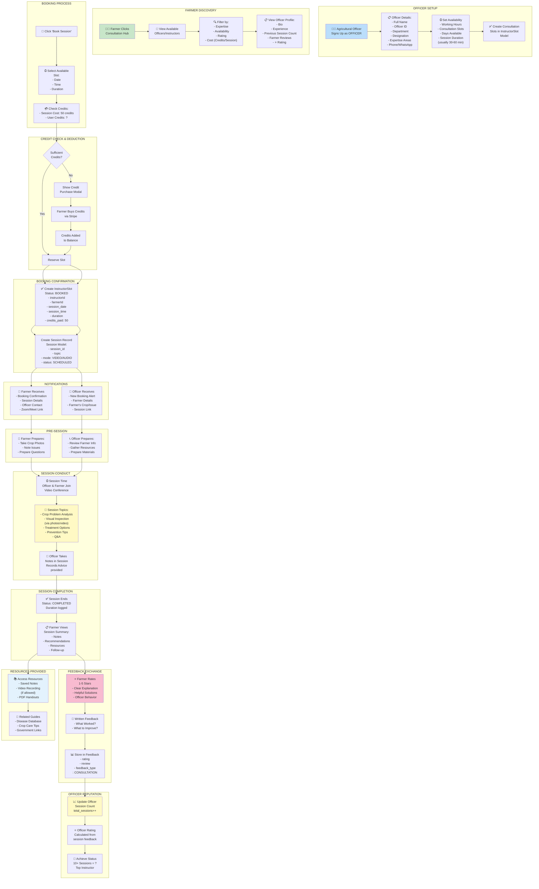
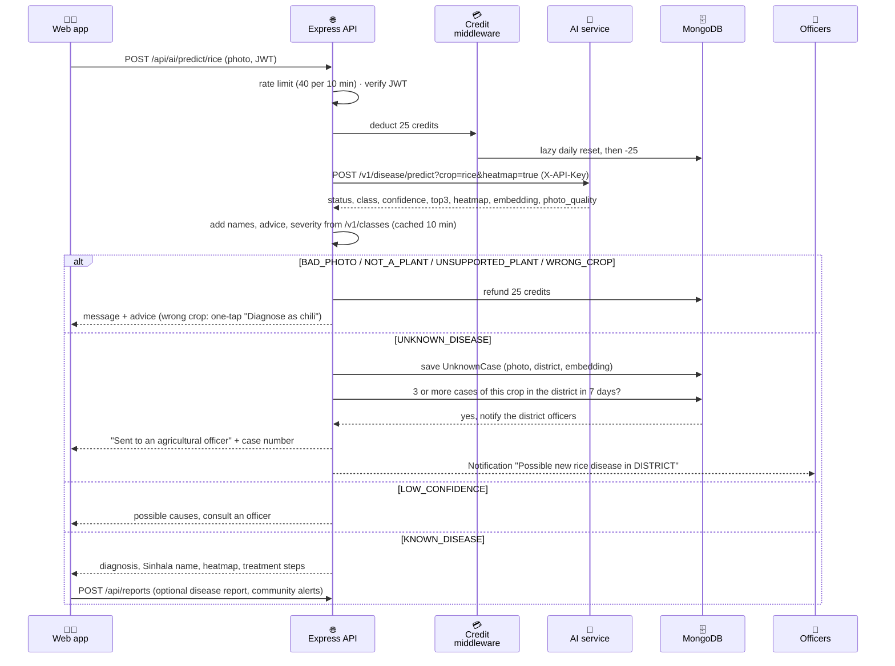
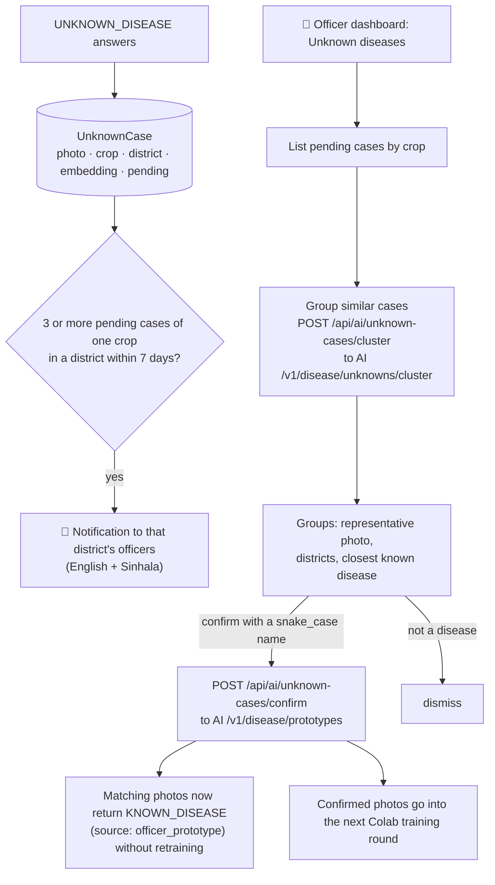
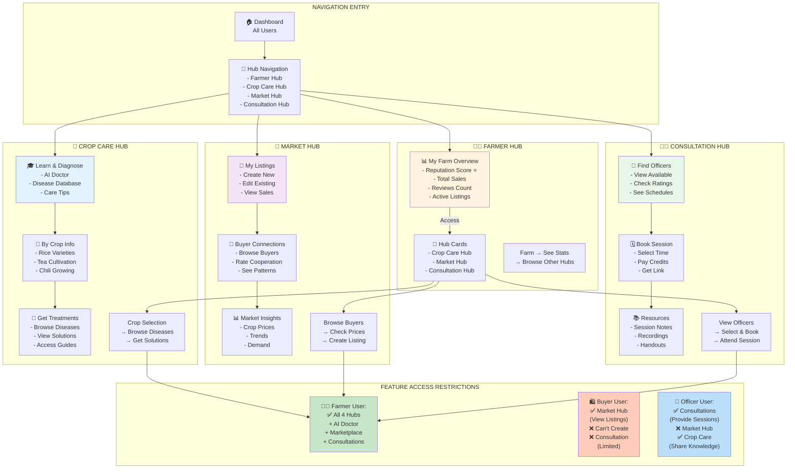
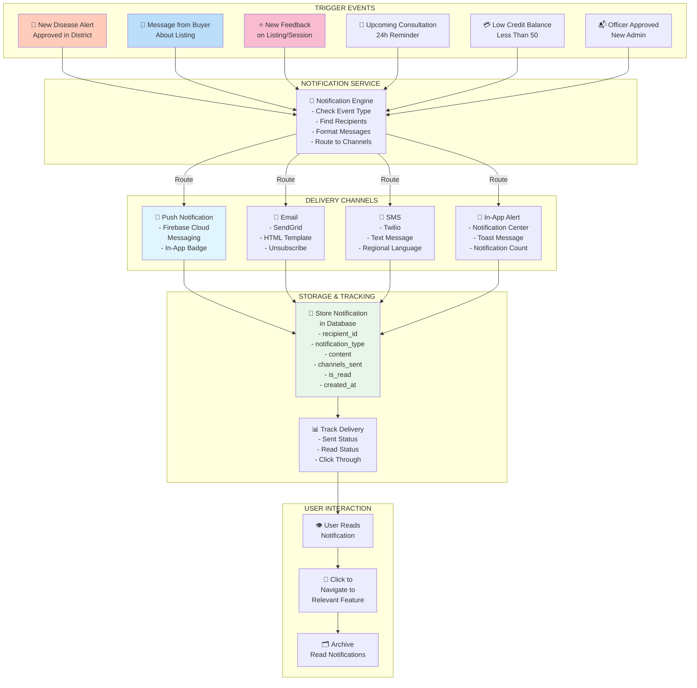
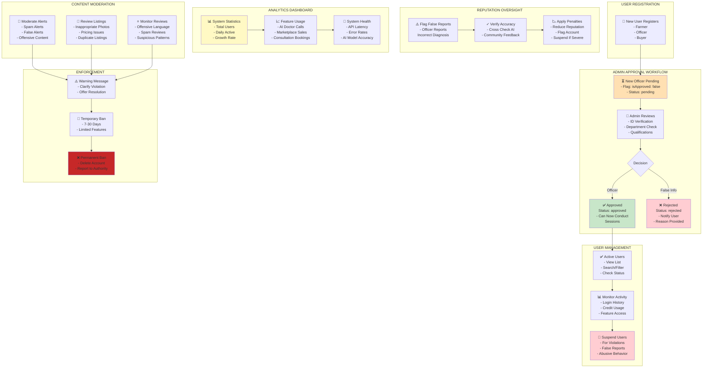

> **v2 note:** the system is now three repositories: `govi-isuru-web` (Next.js), `govi-isuru-api` (this one) and `govi-isuru-ai-service`. Sections 4 and 4a and the integration notes describe the v2 AI flow; the other workflows are unchanged from v1.

# 🔄 Govi Isuru - Feature Integration & Workflow Details

## 1. Complete Disease Detection to Community Alert Flow

```mermaid
graph TB
    START["🌾 Farmer Notices Symptoms<br/>on Crop Leaf"]
    
    START --> OPEN_APP["📱 Opens Govi Isuru App"]
    OPEN_APP --> NAV_HUB["Navigates to<br/>Crop Care Hub"]
    
    NAV_HUB --> OPEN_DOCTOR["Selects AI Doctor<br/>Disease Detection"]
    
    OPEN_DOCTOR --> SELECT_CROP["🌾 Step 1:<br/>Select Crop Type<br/>Rice/Tea/Chili"]
    SELECT_CROP --> UPLOAD_IMG["📸 Step 2:<br/>Upload Leaf Photo"]
    
    UPLOAD_IMG --> CHECK_CREDITS["💳 Pre-Check Credits<br/>Required: 10 credits<br/>Available: ?"]
    
    CHECK_CREDITS -->|Insufficient| SHOW_BUY["Show Credit<br/>Purchase Modal"]
    SHOW_BUY --> BUY_CREDITS["💰 Farmer Buys<br/>Credits (Stripe)"]
    BUY_CREDITS --> ADD_CREDITS["Credits Added<br/>to Account"]
    ADD_CREDITS --> DEDUCT["Deduct 10 Credits<br/>for AI Call"]
    
    CHECK_CREDITS -->|Sufficient| DEDUCT
    
    DEDUCT --> SEND_AI["🚀 Send Request<br/>to FastAPI<br/>AI Service"]
    
    SEND_AI --> PROCESS_AI["🧠 AI Service:<br/>1. Validate Image<br/>2. Load Model<br/>3. Preprocess<br/>4. Inference<br/>5. Generate GradCAM"]
    
    PROCESS_AI --> GET_RESULT["🔍 AI Returns:<br/>- Disease Name<br/>- Confidence (98%)<br/>- Severity<br/>- GradCAM Heatmap"]
    
    GET_RESULT --> DISPLAY["📊 Display Results<br/>to Farmer"]
    
    DISPLAY --> SAVE_REPORT["💾 Save Report<br/>to MongoDB<br/>Disease.js Model"]
    
    SAVE_REPORT --> FARMER_OPTION{Farmer<br/>Decision}
    
    FARMER_OPTION -->|"Keep Private"| PRIVATE["✅ Report Saved<br/>Only Visible to Farmer<br/>Show Treatments"]
    
    FARMER_OPTION -->|"Report to Community"| REPORT_BTN["📢 Click<br/>'Report Alert'"]
    
    REPORT_BTN --> CREATE_ALERT["Create Alert Document<br/>Status: PENDING<br/>Officer Needs Review"]
    
    CREATE_ALERT --> NOTIFY_OFFICER["🔔 Push Notification<br/>to Local Officers<br/>New Alert in District"]
    
    NOTIFY_OFFICER --> OFFICER_LOGIN["👮 Officer Logs Into<br/>Officer Dashboard"]
    
    OFFICER_LOGIN --> OFFICER_VIEW["Views Pending<br/>Disease Reports<br/>- Farmer's Photo<br/>- AI Diagnosis<br/>- GPS Location"]
    
    OFFICER_VIEW --> OFFICER_DECISION{Officer<br/>Confirms?}
    
    OFFICER_DECISION -->|"Reject"| REJECT_ALERT["❌ Status: REJECTED<br/>- False Alarm<br/>- Farmer Notified"]
    
    OFFICER_DECISION -->|"Confirm"| VERIFY_ALERT["✅ Status: APPROVED"]
    
    VERIFY_ALERT --> ADD_EVIDENCE["Officer Optionally:<br/>- Adds Field Evidence<br/>- Photos<br/>- Observations"]
    
    ADD_EVIDENCE --> CREATE_COMMUNITY_ALERT["📢 Create Community-Wide<br/>Alert"]
    
    CREATE_COMMUNITY_ALERT --> CALC_SEVERITY["⚠️ Calculate Severity<br/>1. Location Cluster<br/>2. Weather Check<br/>3. Spread Analysis<br/>4. Assign: Low/Med/High"]
    
    CALC_SEVERITY --> BROADCAST["📡 Broadcast Alert<br/>to All Farmers in<br/>- Same GN Division<br/>- Nearby Districts<br/>- Same Crop Type"]
    
    BROADCAST --> NOTIF_FARMERS["🔔 Farmers Receive:<br/>- Push Notification<br/>- In-App Alert<br/>- Email/SMS"]
    
    NOTIF_FARMERS --> COMMUNITY_VIEW["👥 Farmers View<br/>Disease Alerts<br/>Dashboard:<br/>- Alert Card<br/>- Severity Badge<br/>- Treatments<br/>- Count of Reports"]
    
    COMMUNITY_VIEW --> DISCUSS["💬 Community Discussion<br/>- Share Experiences<br/>- Discuss Solutions<br/>- Post Photos"]
    
    DISCUSS --> TREATMENTS["💊 Access Treatment<br/>Recommendations<br/>- Organic Methods<br/>- Chemical Solutions<br/>- Preventive Measures"]
    
    TREATMENTS --> IMPLEMENT["🌾 Farmers Implement<br/>Solutions"]
    
    IMPLEMENT --> RECOVERY["✅ Disease Controlled<br/>in Area"]
    
    RECOVERY --> ARCHIVE["📂 Alert Archived<br/>Status: RESOLVED<br/>Stored for Analytics"]
    
    PRIVATE --> END["✅ END - Private Report"]
    REJECT_ALERT --> END
    ARCHIVE --> END["✅ END - Community Alert"]

    style START fill:#fff9c4
    style CHECK_CREDITS fill:#ffccbc
    style PROCESS_AI fill:#f3e5f5
    style DISPLAY fill:#c8e6c9
    style FARMER_OPTION fill:#ffe0b2
    style OFFICER_DECISION fill:#ffe0b2
    style BROADCAST fill:#ffccbc
    style COMMUNITY_VIEW fill:#bbdefb
    style TREATMENTS fill:#c8e6c9
    style END fill:#a5d6a7
```



---

## 2. Marketplace Transaction Complete Workflow

```mermaid
graph TB
    subgraph "FARMER PREPARATION"
        F1["👨‍🌾 Farmer Logs In"]
        F2["📝 Navigate to 'Create Listing'"]
        F3["🌾 Enter Crop Details:<br/>- Crop Type<br/>- Variety<br/>- Quality Grade (A/B/C)<br/>- Harvest Date<br/>- Quantity (kg)<br/>- Price (LKR/kg)<br/>- Description"]
    end

    subgraph "IMAGE UPLOAD"
        F4["📸 Upload Images<br/>(Max 5, 5MB each)"]
        F5["✅ Multer Validation:<br/>- File Type Check<br/>- Size Limit Check<br/>- Virus Scan"]
        F6["💾 Save to:<br/>uploads/listings/<br/>listing-{timestamp}-{random}.jpg"]
    end

    subgraph "LISTING PUBLICATION"
        F7["✅ Create Listing Record<br/>in MongoDB<br/>- farmerId<br/>- cropType<br/>- images[]<br/>- status: ACTIVE<br/>- createdAt"]
        F8["📢 Listing Goes Live<br/>Visible to Buyers"]
    end

    subgraph "BUYER DISCOVERY"
        B1["🛍️ Buyer Logs In<br/>(as BUYER role)"]
        B2["🔍 Open Marketplace<br/>or Access via<br/>Market Hub"]
        B3["🎛️ Browse/Filter:<br/>- Crop Type<br/>- District<br/>- Quality<br/>- Price Range"]
        B4["📋 View Listings<br/>See Farmer Profile:<br/>- Name<br/>- Rating ⭐<br/>- Previous Sales<br/>- Verified Badge✓"]
    end

    subgraph "BUYER SAVES & COMMUNICATES"
        B5["❤️ Save to<br/>Saved Listings<br/>(buyer.savedListings)"]
        B6["💬 Contact Farmer<br/>- Click Message Button<br/>- Send Initial Inquiry"]
        B7["📨 Message Sent to:<br/>- Farmer's In-App<br/>- Email Notification<br/>- SMS (optional)"]
    end

    subgraph "FARMER RESPONDS"
        F9["🔔 Farmer Notified<br/>New Message<br/>from Buyer"]
        F10["💬 Farmer Reviews<br/>- Buyer Inquiry<br/>- Buyer Rating<br/>- Previous Purchases"]
        F11["✍️ Farmer Responds:<br/>- Confirms Details<br/>- Negotiates Price<br/>- Suggests Delivery<br/>- Answers Questions"]
    end

    subgraph "NEGOTIATION & BOOKING"
        N1["🤝 Back & Forth<br/>Messaging<br/>Price, Delivery Date<br/>Pickup Location"]
        N2["✅ Agree on Terms:<br/>- Final Price<br/>- Delivery Method<br/>- Pickup Date/Time<br/>- Payment Method"]
    end

    subgraph "MANUAL BOOKING CREATION"
        MB1["📅 Create Manual<br/>Booking Record"]
        MB2["📝 Booking Details:<br/>- buyerId<br/>- farmerId<br/>- listingId<br/>- quantity_ordered<br/>- agreed_price<br/>- delivery_date<br/>- pickup_location<br/>- payment_method"]
        MB3["💾 Store in MongoDB<br/>ManualBooking Model<br/>status: CONFIRMED"]
    end

    subgraph "PAYMENT HANDLING"
        P1["💳 Payment Methods:<br/>1. Cash on Delivery<br/>2. Bank Transfer<br/>3. Mobile Money"]
        P2["📝 Record in System:<br/>- Amount<br/>- Method<br/>- Confirmation<br/>- Invoice Generated"]
    end

    subgraph "PHYSICAL DELIVERY"
        D1["🚚 Pickup/Delivery Day<br/>- Farmer Prepares<br/>  Produce<br/>- Buyer Arrives/<br/>  Delivery"]
        D2["✅ Quality Check<br/>Buyer Inspects<br/>- Quantity<br/>- Freshness<br/>- Quality Grade"]
        D3["💰 Payment Settled<br/>- If COD, Pay Now<br/>- If Transfer, Confirm"]
    end

    subgraph "FEEDBACK & REPUTATION UPDATE"
        FB1["⭐ Feedback Exchange<br/>Buyer Rates 1-5 Stars<br/>Farmer Rates Buyer"]
        FB2["💬 Written Review<br/>(Optional Comments)"]
        FB3["📊 Store Feedback<br/>in Feedback Model<br/>- rating<br/>- review_text<br/>- timestamp<br/>- reviewer_id"]
    end

    subgraph "REPUTATION IMPACT"
        REP1["📈 Update Farmer<br/>Reputation Score<br/>New Avg from all<br/>feedback ratings"]
        REP2["📊 Update Metrics:<br/>- total_sales ++<br/>- total_feedbacks ++<br/>- verified_listings ++"]
        REP3["✅ Check Badge<br/>If avg >= 4.0:<br/>Add Verified Farmer ✓"]
    end

    subgraph "COMPLETION"
        C1["✅ Close Booking<br/>status: COMPLETED"]
        C2["📚 Archive for<br/>Analytics &<br/>History"]
    end

    F1 --> F2 --> F3 --> F4 --> F5 --> F6 --> F7 --> F8

    B1 --> B2 --> B3 --> B4 --> B5 --> B6 --> B7

    F8 -->|visible| B4
    B7 --> F9 --> F10 --> F11

    F11 --> N1 --> N2

    N2 --> MB1 --> MB2 --> MB3

    MB3 --> P1 --> P2

    P2 --> D1 --> D2 --> D3

    D3 --> FB1 --> FB2 --> FB3

    FB3 --> REP1 --> REP2 --> REP3

    REP3 --> C1 --> C2

    style F1 fill:#c8e6c9
    style B1 fill:#bbdefb
    style N1 fill:#fff9c4
    style D1 fill:#ffccbc
    style FB1 fill:#f8bbd0
    style REP1 fill:#fff9c4
    style C2 fill:#a5d6a7
```



---

## 3. Officer Consultation Booking Complete Workflow



---

## 4. AI Doctor System - Complete Request Flow

The backend forwards the photo to the AI service (repo `govi-isuru-ai-service`), which answers with one of seven statuses. Credits are refunded when no diagnosis is possible.



### 4a. Unknown diseases: officer review (new in v2)



---

## 5. Hub Navigation & Feature Access Matrix



---

## 6. Real-Time Notification System



---

## 7. Admin Dashboard - User Lifecycle Management



---

## Key Integration Points

### 1. **Hub-Feature Cross-Integration**
- All 4 hubs share the same user context (credits, reputation, location)
- Navigation between hubs is seamless with data persistence
- Credits deducted apply globally across all hubs

### 2. **AI Service Integration**
- Only the backend calls the AI service (`src/services/aiClient.js`, `X-API-Key`); browsers never see it
- The photo is sent as-is; quality checks and preprocessing happen in the AI service
- Disease names, Sinhala names, descriptions and treatment steps come from the AI service's class catalogue (cached 10 minutes)
- Heatmaps (CAM) are returned with each diagnosis and not stored
- Photos of unknown diseases are stored as `UnknownCase` for officer review

### 3. **Credit System Integration**
- deducted pre-emptively before API calls
- Insufficient credits block requests at middleware
- Premium users have unlimited access
- Daily reset happens lazily on the first paid request of the day
- Credits are refunded when the AI service is down or no diagnosis is possible

### 4. **Database Schema Relationships**
```
User
├── savedListings → [Listing._id]
├── consultationSessions → [Session._id]
├── diseaseReports → [DiseaseReport._id]
├── feedback (received) → [Feedback._id]
└── alerts (created) → [Alert._id]

Listing
├── farmerId → User._id
├── images → [image_ids]
├── manualBookings → [ManualBooking._id]
└── feedback (on listing) → [Feedback._id]

Alert
├── createdBy → User._id (farmer/officer)
├── approvedBy → User._id (officer)
├── diseaseReport → DiseaseReport._id
└── affectedUsers → [User._id] (notified)

Session
├── instructorId → User._id (officer)
├── farmerId → User._id
├── slot → InstructorSlot._id
└── feedback → Feedback._id
```

### 5. **Notification Triggers**
- Disease Alert Approved → Send to affected district
- New Listing Created → Notify related buyers
- Session Booked → Confirm with both parties
- Feedback Received → Notify user
- Low Credits → Show purchase modal

---

## Document Information
- **Last Updated**: March 30, 2026
- **Scope**: Complete feature workflows and integrations
- **Status**: Fully Documented
- **Total Diagrams**: 13 comprehensive flows

